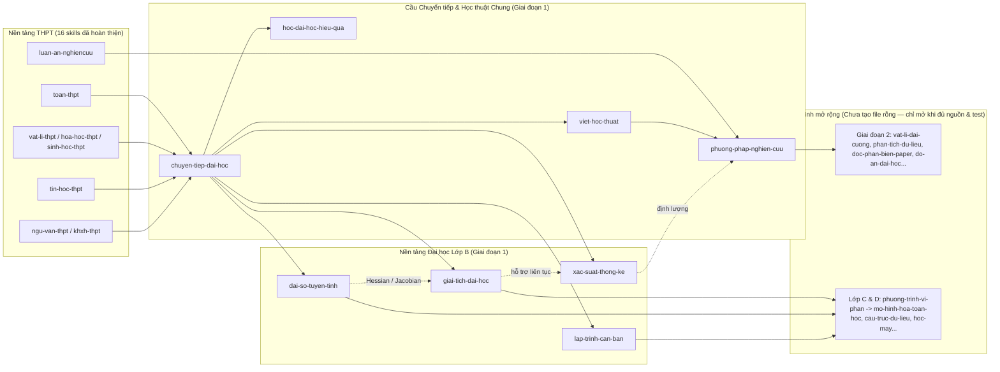

# Bản Đồ Tiên Quyết Đa Ngành (THPT $\to$ Đại Học $\to$ Nghiên Cứu)

Nguồn dữ liệu máy đọc: [`catalog/prerequisite-graph.json`](prerequisite-graph.json).

## Chuỗi tiên quyết mẫu tiêu biểu
- **Chuỗi Giải tích & Mô hình hóa:** `toan-thpt` $\to$ `chuyen-tiep-dai-hoc` $\to$ `giai-tich-dai-hoc` $\to$ *(dự kiến: `phuong-trinh-vi-phan` $\to$ `mo-hinh-hoa-toan-hoc`)*
- **Chuỗi Khoa học Dữ liệu & AI:** `toan-thpt` + `tin-hoc-thpt` $\to$ `chuyen-tiep-dai-hoc` $\to$ (`dai-so-tuyen-tinh` + `xac-suat-thong-ke` + `lap-trinh-can-ban` + `giai-tich-dai-hoc`) $\to$ *(dự kiến: `phan-tich-du-lieu` / `hoc-may`)*
- **Chuỗi Học thuật & Nghiên cứu:** `ngu-van-thpt` / `luan-an-nghiencuu` $\to$ `chuyen-tiep-dai-hoc` $\to$ `hoc-dai-hoc-hieu-qua` + `viet-hoc-thuat` $\to$ `phuong-phap-nghien-cuu` $\to$ *(dự kiến: `doc-phan-bien-paper`, `do-an-dai-hoc`)*
