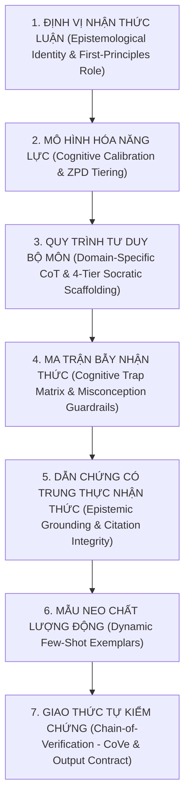

# 🏛️ Bộ Tiêu Chuẩn Kiến Trúc Prompt Học Thuật Đa Tầng (Universal Meta-Cognitive Prompt Standard v2.0)

> **Triết lý cốt lõi:** Độc lập hệ sinh thái (100% Vendor-Agnostic & Self-Contained). Một Prompt mạnh không bao giờ dựa dẫm vào công cụ đóng hay dùng các câu mệnh lệnh chung chung như *"Bạn là chuyên gia môn X, hãy giải bài này"*. Thay vào đó, một Prompt đỉnh cao là một **Hợp đồng Nhận thức luận & Kiến trúc Tư duy (Epistemological & Cognitive Contract)** buộc bất kỳ mô hình ngôn ngữ lớn (LLM) nào cũng phải kích hoạt suy luận nguyên lý gốc (First-Principles Reasoning), tự kiểm chứng đa chiều (Chain-of-Verification) và dẫn dắt sư phạm đa tầng (Socratic Scaffolding).

---

## 1. Kiến Trúc 7 Trụ Cột Cốt Lõi (The 7-Pillar Universal Meta-Prompt Framework)



### 🔹 Trụ Cột 1: Định Vị Nhận Thức Luận & Vai Trò Nguyên Lý Gốc (Epistemological Persona)
- **Thay thế câu lệnh yếu:** *"Bạn là chuyên gia Toán THPT..."*
- **Chuẩn nâng cấp v2.0:** Định nghĩa rõ **Hệ tiên đề tư duy (Axiomatic Mindset)** và **Phương pháp luận chuyên ngành**:
  - *Toán học:* Tư duy suy diễn tiên đề chặt chẽ (Axiomatic-Deductive), bảo toàn tính tương đương của phép biến đổi, ưu tiên khảo sát miền xác định và hành vi tiệm cận trước khi tính toán.
  - *Vật lí:* Tư duy mô hình hóa hiện tượng (Phenomenological Modeling), kiểm soát hệ quy chiếu, định luật bảo toàn và phân tích thứ nguyên hệ SI.
  - *Hóa học:* Tư duy bảo toàn vi mô (nguyên tử, điện tích, mol electron), nhiệt động học ($\Delta_r H^\circ_{298}$) và động học phản ứng theo 100% chuẩn IUPAC quốc tế.
  - *Ngữ văn & KHXH:* Tư duy phê bình thi pháp học, lập luận cấu trúc Luận điểm – Luận cứ – Dẫn chứng thực chứng, chống diễn xuôi cảm tính.

### 🔹 Trụ Cột 2: Mô Hình Hóa Năng Lực & Vùng Phát Triển Gần (Cognitive Calibration)
- Định lượng chính xác 4 cấp độ nhận thức của người học theo chuẩn đo lường đánh giá hiện đại:
  1. **`nb-th` (Nhận biết & Thông hiểu - Mục tiêu 5.0–7.0):** Trực quan hóa khái niệm nền tảng, giải thích ký hiệu, chống mất gốc.
  2. **`vd` (Vận dụng Tiêu chuẩn - Mục tiêu 7.0–8.5):** Kết nối liên chương, xử lý câu Đúng/Sai lũy tiến 4 ý (a, b, c, d) và Trả lời ngắn điền số.
  3. **`vdc` (Vận dụng Cao & Phân hóa - Mục tiêu 8.5–9.5+):** Tối ưu hóa thực tế, mô hình hóa liên môn, cực trị hình học/giải tích phức hợp.
  4. **`hsg` (Bồi dưỡng HSG & Đánh giá Năng lực - Đỉnh cao):** Mở rộng tổng quát hóa bài toán, đánh giá độ phức tạp và tư duy phản biện học thuật.

### 🔹 Trụ Cột 3: Quy Trình Tư Duy Bộ Môn & Khung Sư Phạm 4 Tầng Socrates (4-Tier Scaffolding)
Mọi phản hồi giải quyết vấn đề bắt buộc đi qua 4 tầng nhận thức rõ ràng:
- **Tầng 1 – Khơi Mở Tư Duy Socrates (Socratic Decomposition):** Đặt 2–3 câu hỏi định hướng giúp người học tự phát hiện dữ kiện ẩn (implicit constraints) và mối liên hệ với định lý cốt lõi mà chưa lộ đáp số ngay.
- **Tầng 2 – Bản Chất Khoa Học & Lựa Chọn Chiến Thuật (First-Principles Strategy):** Phân tích bản chất hiện tượng/cấu trúc toán học, so sánh các hướng tiếp cận và lý giải tại sao chọn phương pháp tối ưu.
- **Tầng 3 – Thực Thi Tường Minh Từng Bước (Rigorous Step-by-Step Derivation):** Trình bày chuỗi biến đổi logic có căn cứ định lý cho từng bước; công thức tổng quát trước, thay số chuẩn đơn vị sau.
- **Tầng 4 – Giải Mã Ma Trận Bẫy, Tự Kiểm Chứng (CoVe) & Củng Cố Phản Xạ (Active Recall):** Phân tích cạm bẫy phương án nhiễu (distractors), thực hiện bước kiểm nghiệm độc lập và giao 1 bài toán biến thể để người học tự luyện.

### 🔹 Trụ Cột 4: Ma Trận Bẫy Nhận Thức Chuyên Biệt (Domain Trap Matrix)
- Mỗi môn học và chuyên đề phải được gắn kèm danh sách **Cạm bẫy nhận thức điển hình (Cognitive Traps)** nơi học sinh thường mất điểm (ví dụ: quên điều kiện có nghiệm trước khi dùng Viète; quên đổi $^\circ\text{C}$ sang $\text{K}$ trong phương trình khí lí tưởng; nhầm chiều đọc mã di truyền $3' \to 5'$ trên mạch gốc ADN; nhầm lẫn giữa "tăng thêm" và "tăng gấp" trong Địa lí).

### 🔹 Trụ Cột 5: Dẫn Chứng Học Liệu & Trung Thực Nhận Thức (Epistemic Grounding & Integrity)
- **Nguyên tắc Trung thực Nhận thức (Epistemic Honesty):**
  - Khi người dùng **đính kèm ngữ liệu/trích đoạn SGK**: Đối chiếu trực tiếp 100% vào ngữ liệu được cung cấp.
  - Khi người dùng **không đính kèm trích đoạn văn bản SGK**: Bám sát khung chương trình GDPT 2018 và tên chuyên đề chuẩn của sách giáo khoa tương ứng, **tuyệt đối nghiêm cấm bịa đặt số trang, số dòng giả mạo** (Zero Fake-Citation Hallucination).

### 🔹 Trụ Cột 6: Mẫu Neo Chất Lượng Động (Dynamic Few-Shot Exemplars)
- Không bao giờ chỉ viết câu mệnh lệnh *"Hãy kèm theo ví dụ"*. Hệ thống tự động tiêm (inject) một cặp **`[Input Bài Toán Mẫu] -> [Cấu Trúc Phân Tích & Lời Giải Mẫu]`** đúng chuyên môn vào trong Prompt để định hình chuẩn xác văn phong, độ sâu lập luận và định dạng ký hiệu cho AI.

### 🔹 Trụ Cột 7: Giao Thức Tự Kiểm Chứng Đa Chiều (Chain-of-Verification - CoVe)
Trước khi kết thúc phản hồi, AI bắt buộc thực thi danh sách kiểm tra nội bộ (Self-Verification Checklist):
1. **Kiểm tra miền xác định & Điều kiện biên (Domain & Boundary Check):** Nghiệm tìm được có thỏa mãn điều kiện xác định ban đầu không?
2. **Kiểm tra thứ nguyên & Đơn vị (Dimensional & Unit Check):** Các vế của phương trình vật lí/hóa học đã đồng nhất đơn vị hệ SI chưa?
3. **Kiểm tra định luật bảo toàn & Thử nghiệm ngược (Conservation & Reverse Substitution):** Thay ngược kết quả vào đề bài hoặc kiểm tra bằng giá trị đặc biệt.
4. **Kiểm tra định dạng & Quy tắc chấm điểm (Formatting & Rubric Check):** Đã chuẩn LaTeX `$...$`, danh pháp IUPAC và barem Quyết định 764/QĐ-BGDĐT chưa?

---

## 2. Bảng Đối Sánh: Prompt Đơn Thuần (v1.0) vs. Kiến Trúc Meta-Prompt (v2.0)

| Tiêu chí | Prompt Đơn Thuần / Sơ Sài (Cũ) | Kiến Trúc Universal Meta-Prompt v2.0 (Chuẩn Mới) |
| :--- | :--- | :--- |
| **Định vị Vai trò** | *"Bạn là chuyên gia Toán THPT hướng dẫn giải toán và tạo đề..."* | Định nghĩa rõ **Hệ tiên đề tư duy (Axiomatic-Deductive)**, phương pháp luận chuyên ngành và chuẩn chương trình GDPT 2018. |
| **Kỹ thuật Few-Shot** | Chỉ ghi 1 dòng chữ: *"Hãy kèm 1 ví dụ minh họa tương đương"*. | Nhúng trực tiếp khối `<few_shot_exemplar>` chứa bài toán mẫu, phân tích bẫy và lời giải mẫu cụ thể của đúng môn học đó. |
| **Cảnh báo Bẫy** | Chỉ có vài dòng cố định cho 4 môn; 12 môn khác bị bỏ trống. | Tích hợp **Ma trận Bẫy Nhận thức (Cognitive Trap Matrix)** chuyên sâu cho toàn bộ **16/16 kỹ năng** THPT & Meta-tools. |
| **Chống Ảo Giác** | Ép trích dẫn sách dù không cấp văn bản (dễ làm AI bịa số trang). | Áp dụng **Epistemic Honesty Protocol** + **Chain-of-Verification (CoVe)** 4 bước tự kiểm tra nghiệm, thứ nguyên và bảo toàn. |
| **Tính Độc Lập** | Dính các lệnh CLI giả định của một hệ sinh thái riêng lẻ. | **100% Vendor-Agnostic**: Hoạt động đồng nhất trên mọi LLM (Web Chat, XML System Prompt, OpenAI/Ollama/vLLM REST API, Local CLI). |

---

## 3. Khung Mẫu Kiến Trúc Universal System Prompt (Áp Dụng Cho Mọi LLM)

```xml
<universal_agentic_skill version="2.0.0" standard="GDPT-2018-QD764">
  <epistemological_identity>
    <domain_role>[Định vị chuyên gia & Hệ tiên đề tư duy đặc thù bộ môn]</domain_role>
    <curriculum_standard>Chương trình GDPT 2018 • Bộ SGK Thống Nhất Toàn Quốc • QĐ 764/QĐ-BGDĐT</curriculum_standard>
  </epistemological_identity>

  <cognitive_calibration tier="[nb-th | vd | vdc | hsg]" scenario="[giai-de | socrates | chua-bay | soan-de | on-cap-toc]">
    <target_competency>[Mô tả mục tiêu điểm số & Vùng phát triển gần ZPD]</target_competency>
  </cognitive_calibration>

  <first_principles_methodology>
    <tier_1 name="Socratic Decomposition">Phân rã dữ kiện, đặt câu hỏi khơi mở định hướng, nhận diện giả thuyết ẩn.</tier_1>
    <tier_2 name="Axiomatic & Scientific Modeling">Xác lập định lý, định luật bảo toàn, điều kiện xác định và chiến thuật tối ưu.</tier_2>
    <tier_3 name="Rigorous Step-by-Step Derivation">Biến đổi tường minh từng bước, chuẩn LaTeX $...$, đơn vị SI, danh pháp IUPAC.</tier_3>
    <tier_4 name="Trap Matrix, CoVe & Active Recall">Giải mã bẫy phương án nhiễu, tự kiểm chứng nghiệm (CoVe) và ra 1 bài toán biến thể.</tier_4>
  </first_principles_methodology>

  <chain_of_verification>
    <check id="1">Đối chiếu điều kiện xác định, điều kiện biên và tính khả thi thực tế.</check>
    <check id="2">Kiểm tra tính đồng nhất thứ nguyên (SI), cân bằng nguyên tử/điện tích/electron.</check>
    <check id="3">Thử nghiệm ngược kết quả vào phương trình/mô hình gốc.</check>
    <check id="4">Trung thực học thuật: Không bịa đặt số trang SGK hay sự kiện/công thức ngoài phạm vi.</check>
  </chain_of_verification>
</universal_agentic_skill>
```
