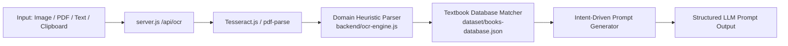

# EduSkills-VN

> Hệ thống Agentic AI Skills, công cụ OCR trích xuất đề bài và bộ tạo prompt có cấu trúc hỗ trợ giáo dục THPT. Ứng dụng tích hợp pipeline chuẩn hóa dữ liệu đa môn (Toán, Vật lí, Hóa học, Ngữ văn) và đối soát tài liệu tham chiếu sách giáo khoa.

---

## Tech Stack

- **Backend Runtime:** Node.js (Native HTTP, CommonJS)
- **Frontend:** React 18 (Client-side execution), Vanilla CSS
- **OCR & Document Extraction:** Tesseract.js (`vie`, `eng`), pdf-parse
- **Data & Configuration:** JSON Schema, CommonJS module exports
- **Protocols:** RESTful HTTP API, CORS-enabled

---

## Core Features

- **Multi-Domain Problem Normalization:**
  - **Toán học:** Chuyển đổi công thức, phân số, căn thức sang cú pháp LaTeX chuẩn (`$...$`).
  - **Vật lí:** Tự động chuẩn hóa đơn vị đo lường theo hệ chuẩn quốc tế SI ($Pa, N, J, K, m/s^2$).
  - **Hóa học:** Quy đổi danh pháp hóa học sang chuẩn IUPAC quốc tế và định dạng biến thiên Enthalpy $\Delta_r H^0_{298}$.
  - **Ngữ văn:** Phân tách cấu trúc ngữ liệu đọc hiểu ngoài SGK và định dạng khung câu hỏi nghị luận xã hội/văn học.
- **Data Ingestion Pipeline:**
  - Hỗ trợ dán trực tiếp ảnh chụp màn hình từ Clipboard (`Ctrl + V`).
  - Đọc và bóc tách nội dung từ tệp hình ảnh (`.png`, `.jpg`, `.webp`) và tệp tài liệu PDF (`.pdf`).
- **Structured Prompt Generation:**
  - Tạo cấu trúc prompt định hướng tác vụ cho LLM (Gemini, Claude, GPT) gồm: vai trò sư phạm, đối tượng học sinh, ràng buộc kỹ thuật, dẫn chứng SGK và nội dung bài tập.
- **Reference Grounding:**
  - Ánh xạ tự động môn học và khối lớp (10, 11, 12) với siêu dữ liệu sách giáo khoa tham chiếu tương ứng trong cơ sở dữ liệu.
- **Dataset Validation:**
  - Tích hợp công cụ dòng lệnh kiểm tra tính toàn vẹn và hợp lệ của hệ thống tệp kỹ năng học tập.

---

## Architecture Pipeline



---

## API Reference

Hệ thống cung cấp các REST API endpoint chạy trên máy chủ local (mặc định cổng `3000`):

| Method | Endpoint | Mô tả |
| :--- | :--- | :--- |
| `POST` | `/api/ocr` | Tiếp nhận ảnh (Base64), PDF hoặc raw text; thực hiện OCR và chuẩn hóa theo môn học. |
| `POST` | `/api/generate-prompt` | Tạo prompt có cấu trúc dựa trên ngữ cảnh môn học, khối lớp và nội dung đề bài. |
| `GET` | `/api/skills` | Trả về toàn bộ danh mục kỹ năng từ `dataset/skills-catalog.json`. |
| `GET` | `/api/skill-content?path=...` | Đọc nội dung tệp kỹ năng cụ thể theo đường dẫn tương đối. |
| `GET` | `/api/validate` | Chạy bộ kiểm thử tính hợp lệ của dataset và cấu trúc kỹ năng. |
| `GET` | `/api/drive-links` | Trả về danh sách liên kết kho tài liệu tham chiếu theo khối lớp. |

---

## Quick Start

### Yêu cầu hệ thống
- **Node.js:** Phiên bản 18.0.0 trở lên.
- **Trình duyệt web:** Chrome, Edge, Firefox hoặc Safari.

### Cài đặt và vận hành

1. **Clone repository:**
   ```bash
   git clone https://github.com/Wothing0406/EduSkills-VN.git
   cd EduSkills-VN
   ```

2. **Cài đặt dependencies:**
   ```bash
   npm install
   ```

3. **Khởi chạy ứng dụng:**
   ```bash
   npm start
   # Hoặc: npm run dev
   ```

4. **Truy cập ứng dụng:**
   - Web Interface: [http://localhost:3000](http://localhost:3000)
   - API Status & OCR: [http://localhost:3000/api/ocr](http://localhost:3000/api/ocr)

*(Trên hệ điều hành Windows, có thể khởi chạy nhanh bằng tệp `run.bat` hoặc `start-eduskills.bat`)*

---

## Project Structure

```
EduSkills-VN/
├── backend/
│   └── ocr-engine.js           # Bộ xử lý OCR, parser ngữ nghĩa đa môn và prompt generator
├── dataset/
│   ├── books-database.json     # Siêu dữ liệu danh mục sách giáo khoa tham chiếu
│   ├── skills-catalog.json     # Danh mục toàn bộ các skills được định nghĩa
│   └── test_prompts.json       # Dữ liệu test case benchmark
├── docs/                       # Tài liệu đặc tả kỹ thuật và tiêu chuẩn kiến trúc
├── scripts/
│   ├── build-dataset.js        # Script tổng hợp dữ liệu skills vào dataset
│   ├── test-suite.js           # Bộ test kiểm thử tự động
│   └── validate-dataset.js     # Script kiểm tra tính toàn vẹn của dataset
├── skills/                     # Định nghĩa nội dung kỹ năng phân môn theo chuẩn markdown
├── web/
│   ├── index.html              # Giao diện web người dùng (React 18)
│   └── skills-data.js          # Dữ liệu tĩnh phục vụ giao diện offline
├── package.json                # Cấu hình dự án và dependencies
├── server.js                   # HTTP server và điều phối API
└── run.bat                     # Script khởi động nhanh trên hệ điều hành Windows
```

---

## Development Scripts

```bash
# Kiểm tra tính toàn vẹn của toàn bộ dataset
npm run validate

# Tổng hợp lại dữ liệu dataset từ các tệp kỹ năng
npm run build

# Chạy test suite kiểm thử
npm test
```

---

## Author

- **Nguyễn Duy Quang** (Project Lead & Author)
  - **Email:** [poiairo4628@gmail.com](mailto:poiairo4628@gmail.com)
  - **Điện thoại:** `0795277227`
  - **GitHub:** [@Wothing0406](https://github.com/Wothing0406)

---

## License

Dự án được phân phối dưới giấy phép [MIT License](https://opensource.org/licenses/MIT).

