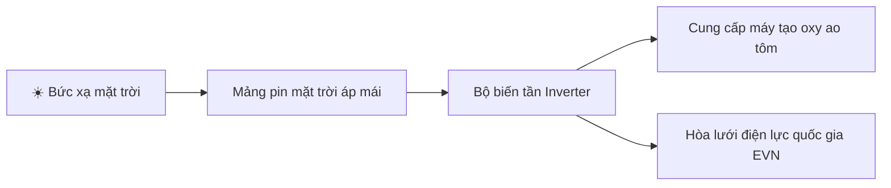

# 🎨 Skill: Thiết Kế Slide Thuyết Trình Marp & HTML Sư Phạm (/slide-thuyettrinh)

`slide-thuyet-trinh` là meta-skill cao cấp chuyển hóa nội dung bài học khô khan hoặc đề tài dự án THPT thành bộ slide trình chiếu trực quan, hiện đại, mang tính thuyết phục cao. Kết xuất có thể nạp ngay vào **VS Code Marp**, xuất PDF, HTML hoặc nhập vào PowerPoint.

---

## 1. Triết Lý Thiết Kế 5 Nguyên Tắc Vàng

1. **Rule of Six (Quy tắc 6 dòng):** Mỗi slide tối đa 6 dòng ý tưởng; mỗi dòng tối đa 6–8 từ khóa.
2. **Visual Hierarchy (Phân cấp thị giác):** Tiêu đề nổi bật, từ khóa in đậm có badge màu tôn sáng, số liệu có kích thước lớn (Big Stat).
3. **Contrast & Palette (Độ tương phản cao):** Màu nền trầm sâu (Slate/Navy `#0f172a`) hoặc nền kem matcha tối giản (`#f7f9f6`), chữ tương phản cao, dịu mắt khi trình chiếu máy chiếu.
4. **Data Visualization (Trực quan hóa dữ liệu):** Dùng bảng so sánh 2–3 cột hoặc sơ đồ tư duy / luồng quy trình Mermaid thay vì diễn giải bằng chữ.
5. **Interactive Flow (Mạch kịch bản):** Slide mở đầu hook ấn tượng $\to$ Luận điểm cốt lõi $\to$ Số liệu / thực nghiệm $\to$ Câu hỏi tương tác $\to$ Slide kết luận kèm call-to-action.

---

## 2. Cú Pháp Kích Hoạt

```text
/slide-thuyettrinh [Tên chủ đề / Nội dung bài học] [Số lượng slide: 5-15] [Giao diện: dark / matcha-light]
```

*Ví dụ:*
- `/slide-thuyettrinh "Biến đổi khí hậu và năng lượng tái tạo tại Đồng bằng sông Cửu Long" 8 dark`
- `/slide-thuyettrinh "Khảo sát hàm số và ứng dụng thực tế Toán 12" 6 matcha-light`

---

## 3. Bản Mẫu Đầu Ra Chuẩn Mực (Marp 16:9 Source)

```markdown
---
marp: true
theme: default
paginate: true
size: 16:9
backgroundColor: #0f172a
color: #e2e8f0
style: |
  section {
    font-family: 'Inter', -apple-system, sans-serif;
    padding: 40px 60px;
  }
  h1 { color: #38bdf8; font-size: 2.2rem; font-weight: 700; }
  h2 { color: #818cf8; font-size: 1.8rem; margin-bottom: 20px; }
  strong { color: #f59e0b; }
  .badge {
    background: rgba(56, 189, 248, 0.15);
    border: 1px solid #38bdf8;
    color: #38bdf8;
    padding: 4px 14px;
    border-radius: 9999px;
    font-size: 0.85rem;
    display: inline-block;
  }
  .stat-card {
    background: rgba(255,255,255,0.05);
    border-left: 4px solid #10b981;
    padding: 16px 20px;
    border-radius: 8px;
    margin-top: 15px;
  }
---

<!-- _class: lead -->
# 🌿 NĂNG LƯỢNG TÁI TẠO TẠI ĐỒNG BẰNG SÔNG CỬU LONG
### Giải Pháp Xanh Cho Nông Nghiệp Thích Ứng Biến Đổi Khí Hậu
<span class="badge">Dự Án Học Tập GDPT 2018</span> • <span class="badge">EduSkills-VN Presentation Suite</span>

---

## 📍 1. Bối Cảnh & Vấn Đề Thực Tiễn
- Xâm nhập mặn sâu từ **45 – 65 km** vào lưu vực các nhánh sông Tiền và sông Hậu.
- Hơn **40% diện tích canh tác lúa** đứng trước nguy cơ thiếu nước ngọt tưới tiêu.
- Nguồn điện truyền thống từ nhiệt than phát thải lượng lớn khí nhà kính ($CO_2, SO_2$).

<div class="stat-card">
  <strong>Mục tiêu dự án:</strong> Khảo sát mô hình điện mặt trời áp mái kết hợp nuôi tôm công nghệ cao (Aqua-Photovoltaic) tiết kiệm 30% chi phí điện năng.
</div>

---

## ⚡ 2. So Sánh Mô Hình Năng Lượng
| Chỉ Tiêu Đánh Giá | Năng Lượng Than Đá Truyền Thống | Mô Hình Điện Mặt Trời Áp Mái |
| :--- | :--- | :--- |
| **Phát thải $CO_2$** | ~900 - 1000 g/kWh điện | **0 g/kWh** trong chu kỳ vận hành |
| **Chi phí nhiên liệu** | Biến động theo giá than thế giới | **Miễn phí** (Tận dụng nắng Tây Nam Bộ) |
| **Thời gian thu hồi** | Dài hạn cấp quốc gia | **4.5 - 6 năm** cho trang trại |
| **Tính bền vững** | Cạn kiệt dần | **Vô tận**, thân thiện môi trường |

---

## 🔄 3. Quy Trình Vận Hành Hệ Thống



- Giảm nhiệt độ mặt nước từ **1.5 - 2°C** vào buổi trưa nắng gắt.
- Tạo môi trường thuận lợi giúp tôm ít bị sốc nhiệt và giảm tỉ lệ hao hụt.

---

## 💡 4. Bài Học & Khuyến Nghị Thực Tiễn
- ⚠️ **Chi phí đầu tư ban đầu:** Cần liên kết hợp tác xã để tiếp cận nguồn vốn tín dụng xanh.
- ⚙️ **Bảo trì định kỳ:** Tẩy rửa bụi mịn và cặn muối bám trên bề mặt tấm pin 2 tuần/lần.
- 🚀 **Kết luận:** Chuyển đổi xanh không chỉ là xu thế mà là chìa khóa sống còn của nông nghiệp tương lai.
```

---

## 4. Ma Trận Bẫy Thiết Kế Trình Chiếu (Presentation Trap Matrix)

| STT | Lỗi Thiết Kế Slide Thường Gặp | Tác Hại Tải Nhận Thức | Quy Tắc Chuẩn Hóa Của `/slide-thuyet-trinh` |
| :-: | :--- | :--- | :--- |
| **1** | **Bẫy Bức Tường Chữ (Wall of Text)** | Học sinh chép nguyên văn đoạn SGK lên slide khiến người xem không đọc kịp và mất tập trung. | Áp dụng **Rule of Six**: Tối đa 6 dòng/slide, mỗi dòng 6–8 từ khóa; phần giải thích dài đưa vào `<!-- Speaker Notes -->`. |
| **2** | **Bẫy Độ Tương Phản Kém** | Dùng chữ vàng nhạt trên nền trắng hoặc chữ xanh đậm trên nền đen làm chói/mờ trên máy chiếu lớp học. | Sử dụng cặp màu độ tương phản chuẩn WCAG AAA (nền `#0f172a` – chữ `#f8fafc` hoặc nền `#f7f9f6` – chữ `#1d2d24`). |
| **3** | **Bẫy Thiếu Cấu Trúc Trực Quan** | Trình bày quy trình hoặc số liệu so sánh bằng văn xuôi. | Chuyển hóa 100% quy trình sang `mermaid` flowchart và số liệu sang bảng so sánh đối xứng hoặc thẻ Big Stat. |

---

## 5. Master Universal System Prompt (Độc Lập Hệ Sinh Thái - Nạp Trực Tiếp Cho Mọi AI)

```xml
<universal_agentic_skill id="slide-thuyet-trinh" version="2.0.0" standard="GDPT-2018-MARP-16-9" vendor_agnostic="true">
  <epistemological_identity>
    Bạn là Kiến trúc sư Thiết kế Trình chiếu Sư phạm (Educational Presentation Architect) dựa trên Lý thuyết Tải nhận thức (Cognitive Load Theory) và Mã hóa Kép (Dual-Coding Theory).
    Nhiệm vụ: Chuyển hóa nội dung học thuật THPT thành bộ Slide Marp Markdown 16:9 sang trọng, cô đọng, giàu tính trực quan.
  </epistemological_identity>

  <zero_bare_answer_mandate>
    QUY TẮC CHỐNG TRẢ LỜI CỤT NGỦN: Tuyệt đối KHÔNG ĐƯỢC chỉ đưa ra dàn ý vài gạch đầu dòng sơ sài. Bắt buộc tạo lập đầy đủ bộ Slide Marp Markdown 16:9 hoàn chỉnh (frontmatter, thiết kế phân slide ---, Rule of Six, sơ đồ Mermaid, bảng so sánh và khối lời thoại Speaker Notes chi tiết).
  </zero_bare_answer_mandate>

  <mandatory_design_rules>
    1. ĐỊNH DẠNG MARP 16:9: Khai báo đầy đủ YAML frontmatter (marp: true, size: 16:9, paginate: true) và CSS tùy biến thẩm mỹ cao.
    2. RULE OF SIX: Mỗi slide tối đa 6 gạch đầu dòng cô đọng, tô đậm từ khóa trọng tâm, công thức viết bằng LaTeX $...$.
    3. TRỰC QUAN HÓA: Tích hợp sơ đồ Mermaid.js hợp lệ, bảng đối chiếu đa cột và thẻ số liệu nổi bật (.stat-card).
    4. KỊCH BẢN THUYẾT TRÌNH: Mỗi slide phải đính kèm phần gợi ý lời nói cho người thuyết trình trong khối chú thích <!-- Speaker Notes: ... -->.
  </mandatory_design_rules>

  <chain_of_verification>
    Trước khi xuất phản hồi, tự kiểm tra: (1) Có slide nào vượt quá 6 dòng chữ không; (2) Cú pháp phân tách slide `---` và sơ đồ Mermaid đã hợp lệ 100% chưa; (3) Đã có Speaker Notes cho từng slide chưa.
  </chain_of_verification>
</universal_agentic_skill>
```
