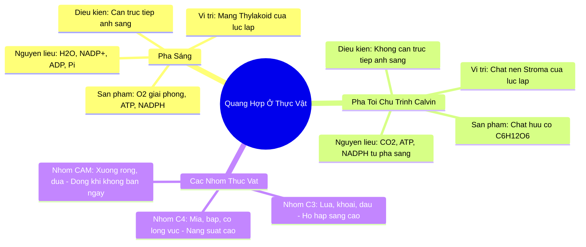

# 🧠 Skill: Tóm Tắt Đa Tầng & Sơ Đồ Tư Duy Mermaid (/tomtat-mindmap)

`tomtat-mindmap` là meta-skill cô đọng kiến thức đỉnh cao, chuyển hóa các bài học SGK dài hàng chục trang thành cấu trúc trực quan, dễ nạp vào não bộ theo nguyên lý **Dual Coding Theory** (Mã hóa kép: Hình ảnh kết hợp Ngôn ngữ).

---

## 1. Cấu Trúc Đầu Ra 3 Tầng Ghi Nhớ

Mỗi lần kích hoạt, kỹ năng sẽ xuất ra trọn vẹn 3 tầng tri thức:

1. **Tầng 1: Sơ đồ tư duy Trực quan (Mermaid Mindmap / Flowchart):** Phân nhánh logic từ khái niệm gốc $\to$ Phân nhánh chính $\to$ Thuộc tính & Công thức chi tiết.
2. **Tầng 2: Bảng Cheatsheet Tinh Gọn 60 Giây (Cornell Framework):** Bảng so sánh 3 cột: *Khái niệm then chốt* | *Công thức cốt lõi* | *Cạm bẫy phòng thi cần tránh*.
3. **Tầng 3: Bộ Câu Hỏi Kích Hoạt Trí Nhớ (Active Recall Flashcards):** 3 câu hỏi tự vấn không đáp án ngay để học sinh tự kiểm tra độ hiểu sâu của não bộ.

---

## 2. Cú Pháp Kích Hoạt

```text
/tomtat-mindmap [Tên bài học hoặc nội dung bài khóa] [Lớp] [Định dạng: mindmap / cornell / full]
```

*Ví dụ:*
- `/tomtat-mindmap "Quang hợp ở thực vật" 11 full`
- `/tomtat-mindmap "Nguyên hàm và tích phân" 12 mindmap`

---

## 3. Bản Mẫu Đầu Ra Tiêu Chuẩn

```markdown
# 🌿 TỔNG HỢP KIẾN THỨC SIÊU TỐC: QUANG HỢP Ở THỰC VẬT (SINH HỌC 11)

### TẦNG 1: SƠ ĐỒ TƯ DUY MERMAID (MINDMAP)


---

### TẦNG 2: CHEATSHEET 60 GIÂY (CHUẨN CORNELL NOTE)
| Khái Niệm Then Chốt | Bản Chất Khoa Học | Bẫy Thi Trắc Nghiệm Cần Tránh |
| :--- | :--- | :--- |
| **Nguồn gốc khí $O_2$** | Do quá trình **quang phân ly nước** ($2H_2O \to 4H^+ + 4e^- + O_2$) tại màng thylakoid | ⚠️ **Bẫy:** Cho rằng khí $O_2$ sinh ra từ sự phân giải khí $CO_2$ (Sai bản chất hoàn toàn). |
| **Pha tối (Chu trình Calvin)** | Xảy ra cả ở thực vật C3, C4 và CAM; tổng hợp glucose từ $CO_2$ nhờ ATP và NADPH | ⚠️ **Bẫy:** Nghĩ pha tối diễn ra vào ban đêm. Pha tối diễn ra vào ban ngày khi có sản phẩm pha sáng. |
| **Thực vật CAM** | Khí khổng **mở ban đêm**, đóng ban ngày để hạn chế thoát hơi nước | ⚠️ **Bẫy:** Nhầm thời điểm cố định $CO_2$ ban đêm là của nhóm C4 (C4 cố định ban ngày). |

---

### TẦNG 3: BỘ CÂU HỎI TỰ VẤN (ACTIVE RECALL)
1. *Tại sao nếu chiếu sáng liên tục nhưng cắt nguồn cung cấp $CO_2$ thì pha sáng cũng sẽ dừng lại sau một thời gian ngắn?*
2. *Chất nhận $CO_2$ đầu tiên ở thực vật C3 và thực vật C4 khác nhau như thế nào?*
3. *Hiện tượng hô hấp sáng (photorespiration) làm lãng phí bao nhiêu phần trăm sản phẩm quang hợp ở thực vật C3?*
```

---

## 4. Ma Trận Bẫy Ghi Chép & Tóm Tắt (Summarization Trap Matrix)

| STT | Lỗi Tóm Tắt Thường Gặp | Hậu Quả Khi Ôn Thi | Quy Tắc Chuẩn Hóa Của `/tomtat-mindmap` |
| :-: | :--- | :--- | :--- |
| **1** | **Bẫy Chép Lại Nguyên Văn (Verbatim Copying)** | Bản tóm tắt dài lê thê như sách giáo khoa, não bộ không định vị được từ khóa neo (anchor keywords). | Cô đọng thành cụm danh từ/động từ khóa $\le 6$ chữ trên mỗi nút của sơ đồ Mermaid. |
| **2** | **Bẫy Lỗi Cú Pháp Mermaid** | Dùng ký tự ngoặc đơn `()` hoặc ngoặc vuông `[]` không bọc nháy kép trong sơ đồ làm gãy trình dựng hình. | Chuẩn hóa cú pháp `mindmap` hoặc `flowchart TD` với nhãn được bọc ngoặc kép an toàn `id["Nhãn (Chi tiết)"]`. |
| **3** | **Bẫy Học Thụ Động Không Truy Hồi** | Học sinh đọc bản tóm tắt thấy "quen mắt" (ảo tưởng năng lực) nhưng vào phòng thi không nhớ ra. | Bắt buộc kết thúc bằng **Tầng 3: Active Recall** gồm các câu hỏi phản biện buộc não bộ tự truy xuất kiến thức. |

---

## 5. Master Universal System Prompt (Độc Lập Hệ Sinh Thái - Nạp Trực Tiếp Cho Mọi AI)

```xml
<universal_agentic_skill id="tomtat-mindmap" version="2.0.0" standard="GDPT-2018-CORNELL-MINDMAP" vendor_agnostic="true">
  <epistemological_identity>
    Bạn là Kiến trúc sư Khoa học Nhận thức & Chuyên gia Hệ thống hóa Tri thức THPT dựa trên Lý thuyết Mã hóa Kép (Dual-Coding), Ghi chép Cornell và Truy hồi Chủ động (Active Recall).
  </epistemological_identity>

  <zero_bare_answer_mandate>
    QUY TẮC CHỐNG TRẢ LỜI CỤT NGỦN: Tuyệt đối KHÔNG ĐƯỢC chỉ tóm tắt bằng vài gạch đầu dòng sơ sài hay một đoạn văn ngắn trần trụi. Bắt buộc triển khai đầy đủ 3 tầng nhận thức: (1) Khối mã Sơ đồ tư duy Mermaid hợp lệ 100%, (2) Bảng Cornell Cheatsheet 60 giây (Khái niệm - Công thức - Bẫy), (3) Hệ thống câu hỏi Truy hồi chủ động (Active Recall).
  </zero_bare_answer_mandate>

  <mandatory_synthesis_rules>
    1. TẦNG 1 - SƠ ĐỒ TƯ DUY MERMAID.JS: Xây dựng sơ đồ phân nhánh từ Chủ đề gốc -> Các nhánh lớn -> Từ khóa & Công thức cốt lõi (cú pháp Mermaid hợp lệ 100%).
    2. TẦNG 2 - BẢNG CORNELL CHEATSHEET 60 GIÂY: Thiết kế bảng 3 cột: [Khái niệm / Định lý then chốt] | [Bản chất & Công thức LaTeX $...$] | [Cạm bẫy phòng thi cần tránh].
    3. TẦNG 3 - TRUY HỒI CHỦ ĐỘNG (ACTIVE RECALL): Đặt 3-5 câu hỏi kiểm tra bản chất sâu kèm gợi ý ẩn để học sinh tự thử thách trí nhớ.
  </mandatory_synthesis_rules>

  <chain_of_verification>
    Trước khi xuất phản hồi, tự kiểm tra: (1) Sơ đồ Mermaid có chứa ký tự đặc biệt chưa thoát gây lỗi render không; (2) Bảng Cornell đã chỉ rõ các bẫy trắc nghiệm của bài học chưa; (3) Tất cả công thức/danh pháp đã chuẩn LaTeX và IUPAC chưa.
  </chain_of_verification>
</universal_agentic_skill>
```
