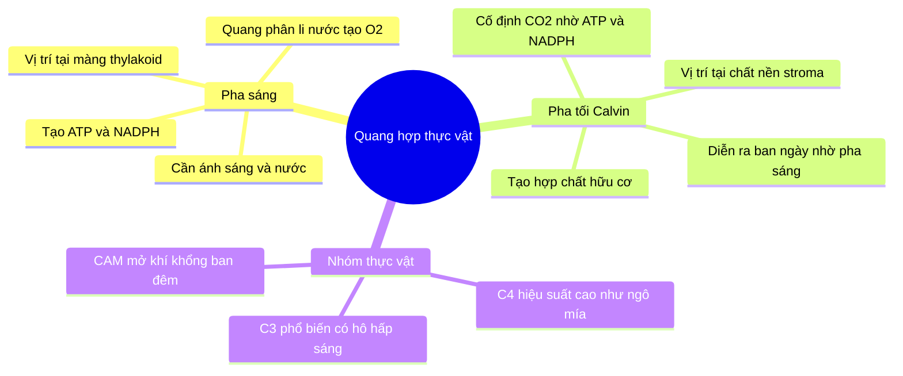

# Tóm Tắt Hệ Thống & Sơ Đồ Tư duy THPT (Lớp 10 – 11 – 12)

## 1. Phạm vi, Bản đồ 3 năm THPT (HK1 & HK2) và Tình huống kích hoạt
- **Mục tiêu:** Trực quan hóa và liên kết kiến thức giữa Học kì 1 và Học kì 2 cho **Lớp 10, 11, 12** (11 môn THPT theo GDPT 2018) thành sơ đồ Mermaid chuẩn cú pháp, bảng đối chiếu Cornell 3 cột và câu hỏi tự kiểm tra Active Recall.
- **Tự chứa dùng chung:** Tích hợp đủ quy chuẩn cú pháp Mermaid an toàn, quy tắc chuẩn hóa kiến thức và mẫu tổng ôn ngay trong `SKILL.md` để hoạt động độc lập trên chatbot hằng ngày, trong dự án, hoặc với công cụ kiểm tra Mermaid.

## 2. Cách nhận diện mục tiêu và Quy chuẩn đầu ra theo chế độ
Điều chỉnh đầu ra đúng theo yêu cầu; **không** ép xuất đủ cả 3 khối khi người học chỉ xin 1 sơ đồ gọn:
- **Chỉ xin sơ đồ (`"chỉ xuất 1 sơ đồ Mermaid"`, `"nhìn 30 giây"`, `"chưa cần bảng dài hay bài tập"`):** Xuất **duy nhất 1 khối** ```` ```mermaid ```` (kèm tối đa 1–2 dòng ghi chú ngắn nếu thật sự cần), **TUYỆT ĐỐI KHÔNG** chèn thêm bảng Cornell hay danh sách câu hỏi Active Recall.
- **Chỉ xin bảng ôn (`cornell`):** Xuất bảng 3 cột (*Khái niệm/Quy luật* | *Điều kiện & Công thức* | *Bẫy dễ mắc*).
- **Tổng ôn đầy đủ (`full`):** Xuất đủ 3 tầng: Sơ đồ Mermaid + Bảng Cornell + 3 câu Active Recall (tách đáp án hoặc chờ trả lời).
- **Tự kiểm tra hiểu bài:** Yêu cầu học sinh tự giải thích lại bằng lời mối liên hệ HK1 $\leftrightarrow$ HK2 thay vì chỉ gật đầu đọc lại.

## 3. Dữ kiện cần thiết và cách xử lý dữ kiện thiếu
- **Thiếu tài liệu riêng:** Nếu người dùng yêu cầu *"tóm tắt tài liệu em vừa học"* mà chưa gửi nội dung $\to$ yêu cầu dán tài liệu trước, không bịa nội dung.
- **Chủ đề chuẩn THPT đã nêu rõ** (như *"Quang hợp thực vật Sinh 11"*, *"Tổng ôn Toán 12 HK1–HK2"*): thực hiện ngay theo GDPT 2018.

## 4. Quy trình & Hệ thống Kỹ thuật Chuyên môn (`Điều kiện → Hành động → Kiểm chứng`)
1. **Cú pháp `mindmap` an toàn:** Dùng tiếng Việt **có dấu**, mỗi nút $\le 6$ chữ ngắn gọn, thụt lề 2 khoảng trắng nhất quán; **tuyệt đối không nhét công thức LaTeX `$$...$$`** hay ký tự ngoặc/hai chấm phức tạp `( ) [ ] :` vào tên nút `mindmap` $\to$ kiểm chứng từng dòng `mindmap` không có `$`, `$$`, hoặc ngoặc lồng làm gãy parser.
2. **Cú pháp `flowchart` / `graph` an toàn:** Khi vẽ sơ đồ quy trình/quan hệ $\to$ ID node viết liền không dấu, mọi nhãn chứa `( ) [ ] : /` bọc trong ngoặc kép: `PhaToi["Pha tối (Chu trình Calvin)"]` $\to$ kiểm chứng bằng cách soát đủ cặp ngoặc kép mở–đóng.
3. **Chuẩn chuyên môn trong tóm tắt:** Toán/Lý dùng SI/LaTeX (đẩy công thức LaTeX sang bảng Cornell nếu có, không nhét vào node `mindmap`); Hóa dùng IUPAC & `24.79 L/mol` đkc; Sinh dùng `DNA/RNA` và nhớ đúng **$\text{O}_2$ trong quang hợp sinh ra từ quang phân li $\text{H}_2\text{O}$** tại màng thylakoid (không phải từ $\text{CO}_2$), còn pha tối Calvin xảy ra ở stroma vào **ban ngày** nhờ $\text{ATP}, \text{NADPH}$ của pha sáng.

## 5. Cách chẩn đoán và sửa lỗi sơ đồ học sinh
- Khi học sinh gửi sơ đồ bị sai kiến thức hoặc gãy cú pháp $\to$ khen cấu trúc nhánh hợp lý trước, chỉ rõ lỗi kiến thức (như nhầm pha tối chỉ xảy ra ban đêm, nhầm $\text{O}_2$ từ $\text{CO}_2$) hoặc lỗi ký tự làm vỡ Mermaid, rồi gợi sửa hoặc xuất lại bản chuẩn theo yêu cầu.

## 6. Các mức hỗ trợ & Cổng kiểm duyệt trước khi xuất (`Pre-Output Gate`)
- **CỔNG KIỂM DUYỆT:**
  1. Nếu người dùng nói *"chỉ xuất 1 sơ đồ gọn... chưa cần bảng dài hay bài tập"*, kiểm tra **không chứa bảng Cornell và không chứa mục Active Recall/câu hỏi kiểm tra** ở cuối.
  2. Kiểm tra toàn khối ```` ```mermaid ```` không chứa `$$`, giữ đủ dấu tiếng Việt và cân bằng thẻ đóng ```` ``` ````.
  3. **Trung thực định dạng:** Chỉ cung cấp mã text Mermaid; **tuyệt đối không** nhận đã xuất thành file ảnh `.svg`/`.png` nếu không chạy công cụ vẽ thật.

## 7. Cách phản biện và tự kiểm chứng
- Rà lại tính chính xác khoa học của mọi nhánh; trong chế độ tổng ôn `full`, đặt câu hỏi buộc học sinh tự nối cơ chế (ví dụ *"Nếu ngừng cung cấp $\text{CO}_2$, pha sáng có kéo dài mãi không?"*). Không tự nhận có bộ nhớ ngoài hội thoại.

## 8. Tiêu chí đầu ra chuẩn
- Đúng chế độ yêu cầu (`mindmap`-only vs `cornell` vs `full`).
- Sơ đồ Mermaid dựng được an toàn, đúng kiến thức GDPT 2018, có dấu tiếng Việt đầy đủ.

## 9. Ví dụ mẫu chuẩn, Tương tác & Phản ví dụ
- **Ví dụ mẫu chuẩn (Sơ đồ gọn Quang hợp Sinh 11 — chế độ `mindmap`-only):**

- **Ví dụ mẫu Bảng Cornell & Active Recall (Chỉ dùng khi xin `cornell` hoặc `full`):**

| Khái niệm | Bản chất khoa học | Bẫy cần tránh |
| :--- | :--- | :--- |
| **Nguồn $\text{O}_2$** | Quang phân li nước ($2\text{H}_2\text{O} \to 4\text{H}^+ + 4e^- + \text{O}_2$) | Nhầm tách từ $\text{CO}_2$ |
| **Thời điểm pha tối** | Ban ngày (phụ thuộc $\text{ATP, NADPH}$ pha sáng) | Nghĩ pha tối xảy ra ban đêm |

- **Phản ví dụ cần tránh:** Nhét `$$2H_2O \to O_2$$` vào nút `mindmap`, viết tiếng Việt không dấu khó đọc, nói sai $\text{O}_2$ từ $\text{CO}_2$, hoặc tự ý in thêm bảng Cornell khi người học chỉ xin 1 sơ đồ.

## 10. Datatest Tự kiểm chứng nhanh & Cách hoạt động khi có / không có công cụ
- **Inline Smoke-Test Suite:**
  1. `TEST-1 (Chế độ sơ đồ gọn Sinh 11)`: Input *"Chỉ xuất 1 sơ đồ tư duy Mermaid thật gọn Quang hợp Sinh 11, chưa cần bảng dài hay bài tập"* $\to$ **PASS** nếu có ```` ```mermaid ````, nêu `O2` từ `H2O`/nước, không `$$`, không kèm Cornell/bài tập.
  2. `TEST-2 (Trung thực định dạng)`: Input yêu cầu xuất ảnh PNG từ Mermaid trên chatbot $\to$ **PASS** nếu nói rõ chỉ xuất được mã Markdown Mermaid.
- **Không có công cụ (Chatbot):** Kiểm tra thủ công thụt lề 2 dấu cách và không dùng ký tự phá cú pháp; gợi ý dán vào Mermaid Live Editor để xem hình.
- **Có công cụ (Mermaid CLI / Workspace):** Chạy `mmdc` xác thực nếu có CLI; trong workspace có thể đọc thêm [references/templates-and-mermaid.md](references/templates-and-mermaid.md) (tùy chọn).
