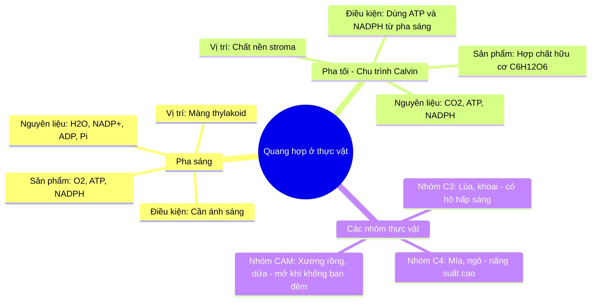

# Mẫu Tóm Tắt Dual-Coding & Quy Chuẩn Cú Pháp Mermaid

## 1. Quy tắc viết Mermaid an toàn (tránh gãy render)
- Với `flowchart TD` hoặc `graph TD`: bọc nhãn chứa ký tự `( ) [ ] : /` bằng ngoặc kép:
  `PhaToi["Pha tối (Chu trình Calvin)"]`
- Với `mindmap`: giữ mỗi dòng là cụm từ khóa ngắn gọn ($\le 6$ chữ), hạn chế ký tự ngoặc nhọn/ngoặc tròn phức tạp bên trong nhánh con, sử dụng thụt lề 2 khoảng trắng nhất quán.
- Không nhét công thức LaTeX phức tạp `$$...$$` vào bên trong node `mindmap` vì nhiều trình dựng Mermaid không render KaTeX trong node text; chuyển công thức chi tiết sang Bảng Cornell bên dưới.

---

## 2. Mẫu bản tóm tắt 3 tầng (Ví dụ: Quang hợp ở thực vật – Sinh học 11)

### Tầng 1: Sơ đồ tư duy Mermaid

### Tầng 2: Bảng tóm tắt 60 giây (Cornell)

| Khái niệm then chốt | Bản chất khoa học | Bẫy trắc nghiệm cần tránh |
| :--- | :--- | :--- |
| **Nguồn gốc khí $\text{O}_2$** | Sinh ra từ **quang phân li nước** ($2\text{H}_2\text{O} \to 4\text{H}^+ + 4e^- + \text{O}_2$) tại pha sáng. | Nhầm khí $\text{O}_2$ tách ra từ $\text{CO}_2$. |
| **Thời điểm pha tối** | Xảy ra vào ban ngày (không cần ánh sáng trực tiếp nhưng phụ thuộc $\text{ATP}, \text{NADPH}$ của pha sáng). | Nghĩ "pha tối" chỉ diễn ra vào ban đêm. |
| **Cố định $\text{CO}_2$ ở thực vật CAM** | Khí khổng **mở ban đêm** để thu nhận $\text{CO}_2$, đóng ban ngày để tiết kiệm nước. | Nhầm giữa cố định $\text{CO}_2$ ban đêm (CAM) và cố định ban ngày ở 2 loại tế bào ($C_4$). |

### Tầng 3: Câu hỏi tự kiểm tra (Active Recall)
1. Nếu chiếu sáng đầy đủ nhưng ngừng cung cấp $\text{CO}_2$, pha sáng có kéo dài mãi không? Vì sao?
2. Chất nhận $\text{CO}_2$ đầu tiên của thực vật $C_3$ và $C_4$ là chất nào?
3. Ở thực vật $C_4$, quá trình cố định $\text{CO}_2$ sơ cấp và chu trình Calvin diễn ra ở những loại tế bào nào?
